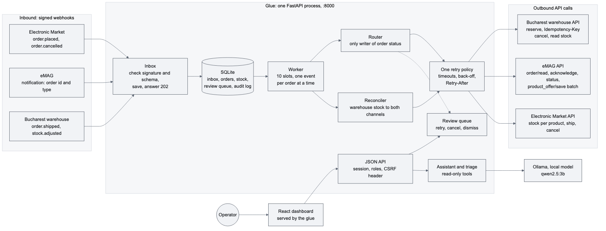

# ADB Glue Service

A small glue service between an online shop, a marketplace and a warehouse.

A reseller sells on its own Adobe Commerce shop and on eMAG, from one warehouse in Bucharest. Today people copy orders and stock between the three systems by hand, so the last unit sometimes sells twice and orders get lost or entered twice. This service does it automatically: every order reaches the warehouse once, the real stock goes back to both channels, and anything it cannot decide safely goes to a person.

- Customer context and value: [docs/customer-context.md](docs/customer-context.md)
- Design note and diagrams: [docs/architecture.md](docs/architecture.md)

## Run it

Needs Docker Desktop.

```sh
docker compose up --build
```

| Address | What it is |
|---|---|
| http://localhost:8000 | Glue dashboard. Sign in as `admin` / `admin` |
| http://localhost:8001 | The shop (mock of Adobe Commerce) |
| http://localhost:8002 | eMAG seller center (mock) |
| http://localhost:8003 | The warehouse (mock) |

Other users: `operator` / `operator` can decide review items, `viewer` / `viewer` can only read. The first start downloads a small local AI model (about 2 GB, once); everything else works right away. On the **Demo controls** page you can break things on purpose: stop the warehouse, send an order twice, sell the last unit on both channels.

Without Docker (Python 3.12+ and Node): `python3 scripts/run_local.py`.

Tests:

```sh
docker compose run --rm --no-deps --build glue pytest -q   # backend, 245 tests
cd frontend && npm ci && npm test                          # dashboard, 223 tests
```

## How it works



The core is six files in `glue/`. Read them in this order:

1. `inbox.py`: checks the signature, saves the event, answers 202. If processing fails later, nothing is lost.
2. `worker.py`: processes the saved events, one order at a time.
3. `router.py`: sends orders to the warehouse. The only place that changes an order's status.
4. `retry.py`: one retry policy for every call to another system.
5. `reconciler.py`: reads the warehouse stock and pushes it to both channels, every 10 seconds and after every change.
6. `review.py`: the queue of things a person decides.

Everything else is the dashboard, an optional AI helper and the three mock systems.

## Assumptions

- Shop events can arrive twice or out of order (Adobe Commerce delivers at least once). eMAG keeps sending a new order until we acknowledge it.
- The warehouse owns the stock. Its number is the truth.
- The first order that reaches the warehouse gets the unit. The other one goes to a person, because cancelling a paid order, and hurting the eMAG seller rating, is a business decision.
- The product code is the same in all three systems.
- Payments, couriers and returns are out of scope.

## Conflicts, retries and partial failures

- **Duplicates** are dropped three ways: by event id, by order id, and the warehouse ignores a repeated request (Idempotency-Key).
- **Retries:** 5 tries with backoff, respecting `Retry-After`. After that the order goes to the review queue.
- **Partial failures:** if eMAG refuses one product in a batch, only that one is retried on the next run.
- **Crashes:** each change is saved together with its audit row. A test stops the service before each of its 132 database writes and checks that it always recovers correctly (`tests/test_crash_points.py`).

## Trade-offs

- SQLite and one process instead of a message queue. Enough for one reseller, and easy to move later: all SQL is in `glue/db.py`.
- Stock is pushed every 10 seconds even when nothing changed. More calls, but any drift fixes itself.
- A person decides oversells, not an automatic rule.
- Mocks instead of real sandboxes, so every failure can be shown on demand. Real API quirks are not tested.

## Known limitations

- It runs as one instance only.
- The mocks keep their data in memory. After restarting them, start from a fresh Glue database: `docker compose down`, then `docker volume rm glueservice_glue-data`.
- No real connectors, demo sign-in only, demo secrets in `docker-compose.yml`.
- The local model is small and its answers are sometimes vague. It only suggests, it never acts.
- Left out on purpose: couriers, returns, refunds, payments, more than one warehouse.

## Observability

- Every step is written to an audit log and as a JSON log line with a correlation id, so `docker compose logs glue | grep <order id>` follows one order.
- Each order has a timeline in the dashboard. `/metrics` shows what is waiting and for how long; `/health` is a liveness check.

## Scalability

A load test (`python -m scripts.load_probe --orders 300`) gives about 527 orders a second on my laptop. It also found a bug: the worker was capped at 20 orders a second. That is fixed. The first real limit is eMAG's rate limit, not this service. To grow: a real queue with workers split by order, Postgres, and batching the stock updates.

## Use of AI

The ideas, the design and the decisions in this project are mine: the scenario, how the systems talk to each other, who gets the last unit, and that a person decides an oversell. I used Claude Code to turn them into working code, tests and docs. That is what made it possible to build and demo this much in the time I had.

I did not rely on AI inside the product: the AI never acts on an order, the rules are plain code, and the model runs locally so customer data stays on the machine.

## Possible extensions

Real connectors (Adobe I/O Events, the eMAG API), a real queue and Postgres, the customer's own sign-in, and more business rules.
