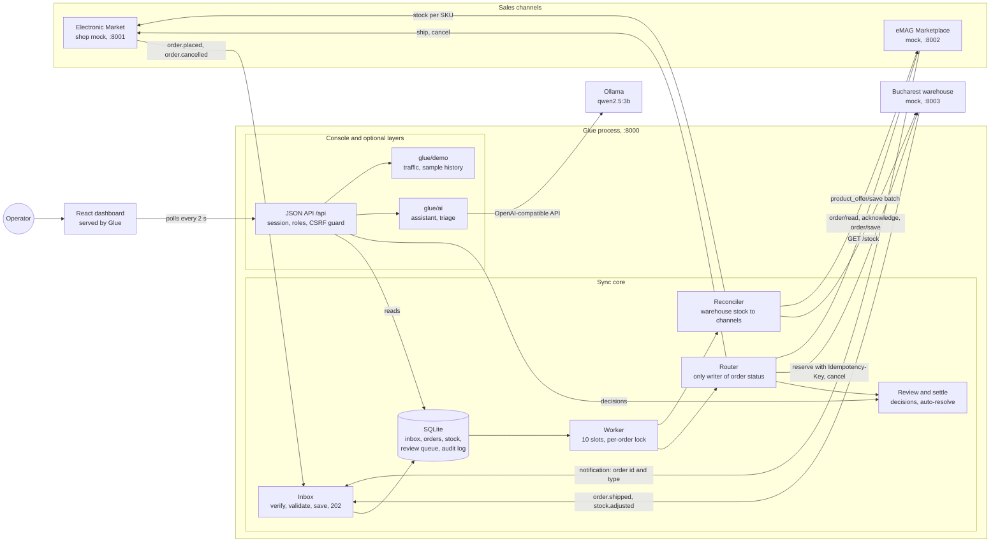
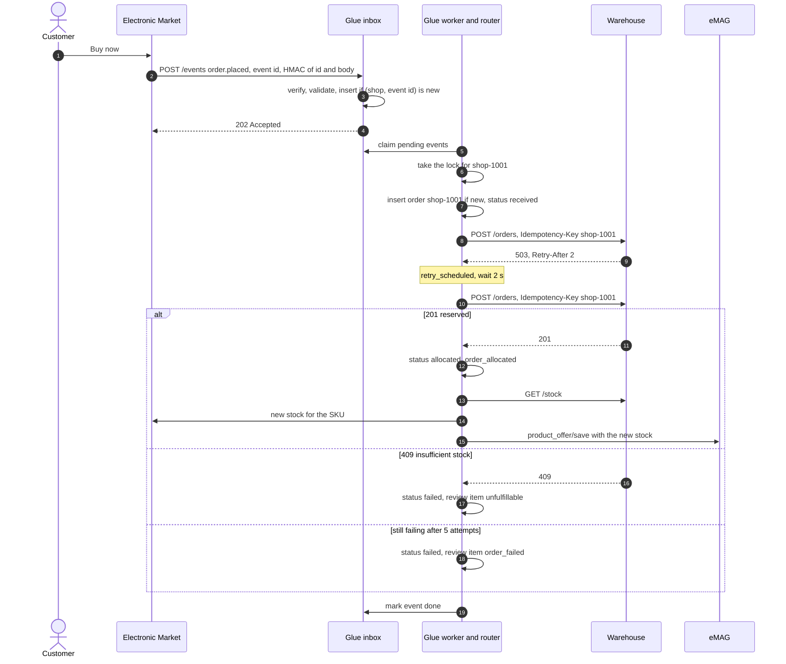
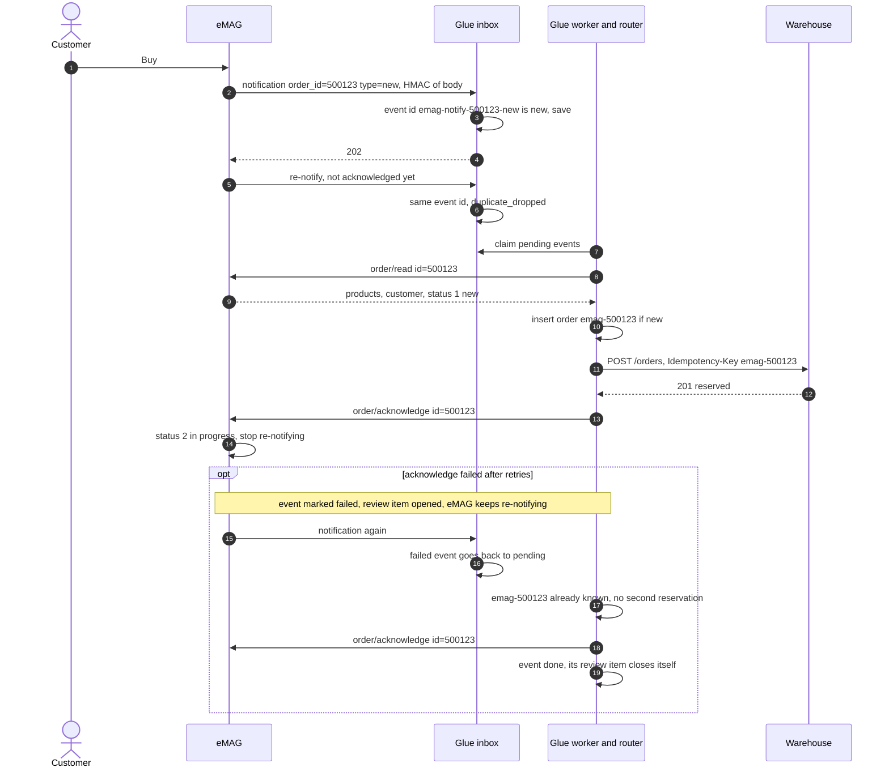
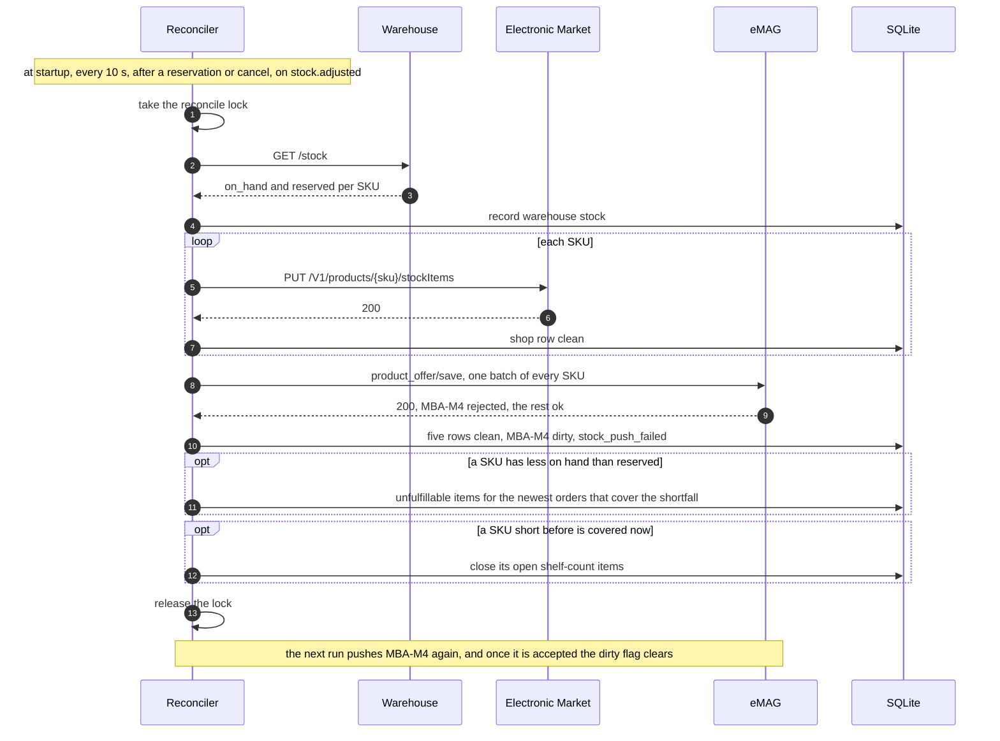
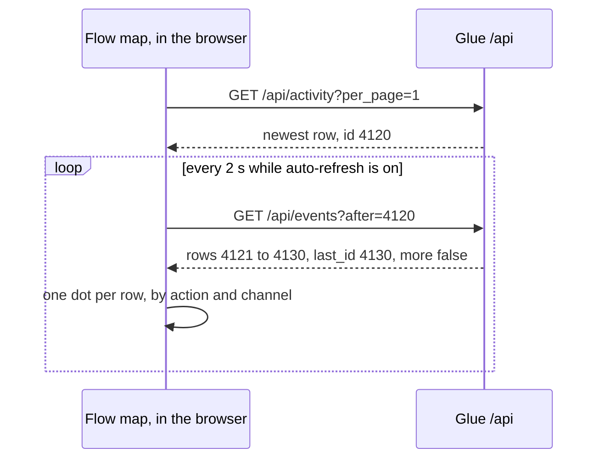
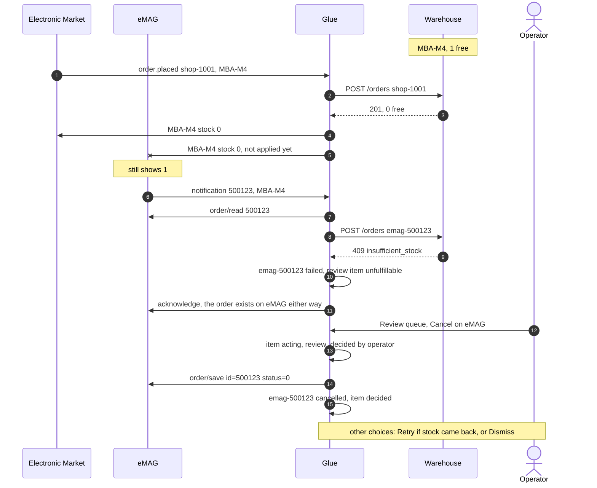
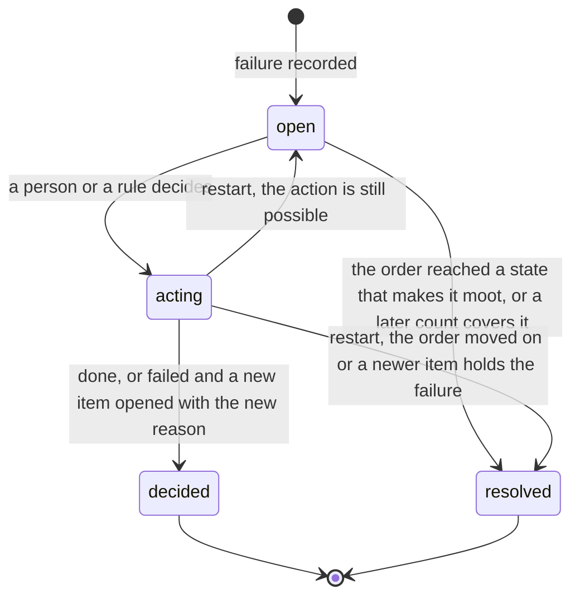
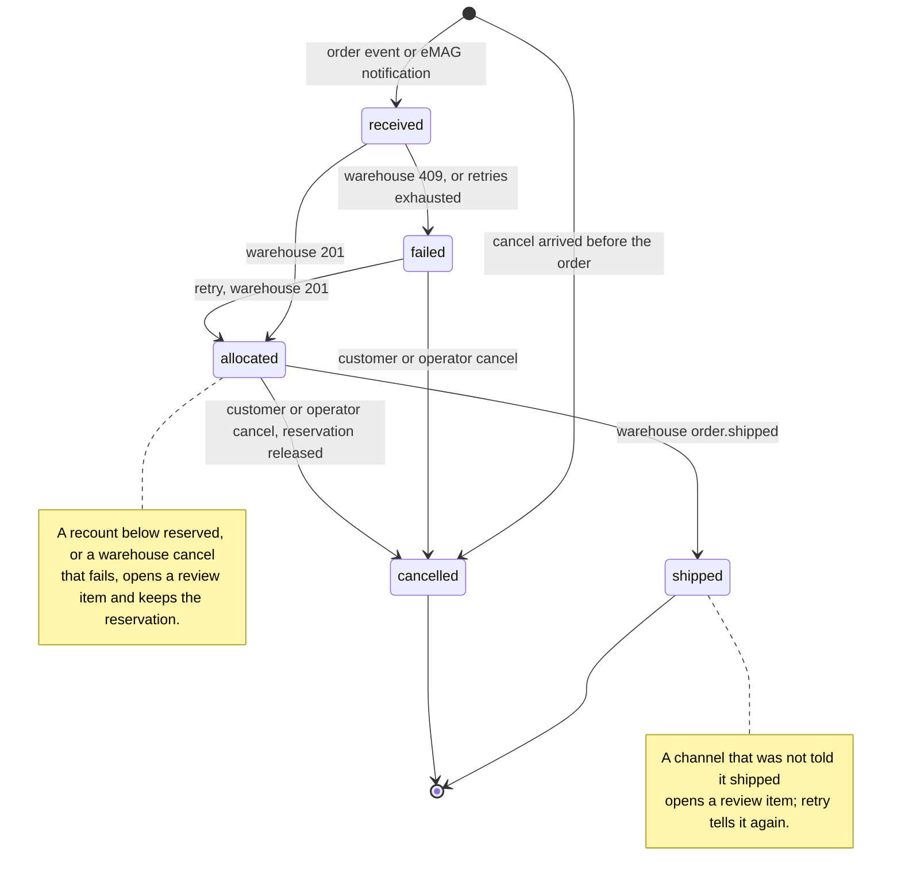

# Architecture

## Components

The three inbound arrows are signed webhooks. Every call Glue makes to the shop, eMAG and the warehouse goes through the same retry policy. Every core module reads and writes the one SQLite file; the diagram shows only the inbox saving and the worker claiming. Not drawn: the demo layer calling the mocks directly (orders, shipments, recounts, fault switches).

Glue is one FastAPI process with one SQLite file. On start it runs the migrations, puts unfinished work back in the queue, pushes stock to both channels, then starts four loops: the worker, the reconciler, the model download, and demo traffic. It serves the webhooks, the JSON API and the built dashboard from one port.

**Mocks.** Each mock is a small FastAPI app with a page for a person (server-rendered Jinja, plain HTML forms) and an API shaped like the real system's. Each has a `/chaos` endpoint the dashboard's demo controls use to break it, or make it act, on purpose. They keep state in memory. Their pages reload every 4 seconds (`common/static/refresh.js`) unless the tab is hidden, a field has focus or has been changed, or a form has been sent and not answered yet.

- *Electronic Market* (Adobe Commerce shape). Sends `order.placed` and `order.cancelled` with an `x-adobe-event-id`. Accepts stock on `PUT /V1/products/{sku}/stockItems`, and ship and cancel calls.
- *eMAG Marketplace* (Marketplace API v4 shape). Notifies Glue with only the order id and type, and re-sends every 20 seconds until the order is acknowledged. Orders are read with `order/read`, moved with `order/save` and numeric statuses; stock arrives in batches through `product_offer/save`, which reports success per item. Faults: rate limit (429, `Retry-After: 1`), refuse one SKU, ignore stock updates, down.
- *Bucharest warehouse*. Owns the stock (`on_hand`, `reserved`). Reserves orders atomically, replays the earlier answer for a repeated `Idempotency-Key`, refuses with 409 when stock is short. Sends `order.shipped` and, after a recount, `stock.adjusted` with an optional note (demo traffic's restocks say "demo restock"). Faults: down (503, `Retry-After: 2`), slow (3 s, longer than Glue's 2 s timeout), fail the next N placements.

## Core, console, AI and demo

| Layer | What it is | Runs in production |
|---|---|---|
| Sync core | Inbox, worker, router, retry, reconciler, review and settle, rules, the database | Yes |
| Operator console | JSON API, the React dashboard, read models, analytics, sign-in and roles | Yes |
| AI helpers | Read-only assistant and triage suggestions, on a local model | Optional |
| Demo layer | The three mocks, demo traffic, sample history, fault switches | No |

Apart from `glue/main.py`, which wires everything together, the core does not import the console or the AI helpers. `glue/context.py` holds two outside types: the model client and the demo traffic state.

## Modules

**Sync core, `glue/`:**

| Module | Job |
|---|---|
| `inbox.py` | `/events` and `/emag/notifications`. Checks the signature, the schema, and that the source may send that event type about that order; saves the event if `(source, event id)` is new, in one transaction with its audit row; answers 202. No other work. |
| `worker.py` | Claims pending events, one task per event, at most `WORKER_CONCURRENCY` (10). Takes the order's lock, runs the handler, and turns any unexpected error into a failed event and a review item. |
| `router.py` | The only code that changes an order's status: place (with the business-level dedupe), import from eMAG, cancel, cancel on the channel, ship and tell the channel. |
| `retry.py` | The one retry policy for every outbound call. Parses and caps `Retry-After`, writes a plain-words retry row, remembers the last trouble per system, and turns exceptions into a reason an operator can read plus the raw error for the log. |
| `reconciler.py` | Reads the warehouse's stock, pushes the sellable figure to both channels, records what each accepted (dirty when refused), sends the newest orders a short shelf cannot cover to review and closes those items once a count covers them, and notices a warehouse recovery. |
| `review.py` | Opens items (one open item per order, kind and failed operation), classifies their cause, says which actions are allowed, and carries out a decision crash-safe. **Retry all** for an outage. |
| `settle.py` | Closes items that an order's new state makes moot, and on start settles decisions a stop cut short. |
| `rules.py` | The two admin rules: the stock buffer (`held_back`) and auto-retry after a warehouse recovery. |
| `db.py`, `schema.sql` | All SQL: the migrations, the startup resets, every query, the gauges. The deliberate exception to the ~150-line module size. |
| `context.py` | What every handler shares: settings, clients, the database, and the in-memory locks and flags. |
| `audit.py` | The list of audit actions; `record()` writes the row and the matching JSON log line. |
| `clients.py` | One small class per system. Ids are URL-encoded into paths. |
| `settings.py`, `tuning.py` | Environment configuration (including `BUSINESS_TIMEZONE`, checked at start), and the live settings an admin changes (stored in the `settings` table). |
| `main.py` | App factory, startup and shutdown, `/health`, `/metrics`. |

**Operator console:**

| Module | Job |
|---|---|
| `glue/api/` | One router per dashboard area: `session`, `overview`, `orders`, `stock`, `review`, `activity`, `events` (the live cursor), `analytics`, `assistant`, `admin` (settings, users, rules), `demo`. Every route sits behind the cross-site guard, and every protected route declares its permission. |
| `glue/queries.py` | Read models: counters, stock rows and their state, review items with their allowed actions, system states, `/metrics`. |
| `glue/analytics.py`, `analytics_series.py`, `ranges.py` | The Flow page's report, computed from the audit log, and the time windows, cut in the business timezone. |
| `glue/auth.py`, `guard.py` | Session cookie, roles, `require(permission)`; the cross-site guard. |
| `glue/spa.py` | Serves the built dashboard, and `index.html` for its client-side routes. |
| `frontend/src/api/` | `fetch` wrapper (adds `X-Glue-Request: 1` to writes, sends to sign-in on 401), TanStack Query hooks, the events cursor. |
| `frontend/src/pages/` | One folder per page: Overview, Flow, Orders, OrderDetail, Stock, Review, Activity, Assistant, Demo, Rules, Settings, Users. |
| `frontend/src/features/` | `flowmap/` (the live map and its dots), `palette/` (the Ctrl+K command palette). |
| `frontend/src/components/`, `layout/`, `lib/`, `styles/` | Shared components, the app shell, labels and formatting, CSS tokens. |

**AI helpers, `glue/ai/`:** `llm.py` (client, model status, one-time download with progress), `assistant.py` (tool loop over five read-only tools), `facts.py` (the live facts and the dashboard's words for the assistant), `triage.py` (asks for a suggestion, filters it, stores it), `triage_prompt.py` (the facts and the rule, built in code).

**Demo layer:** `glue/demo/traffic.py` (random orders, shipments, restocks through a warehouse recount marked "demo restock", and the one-off actions), `glue/demo/sample.py` and `sample_orders.py` (30 days of seeded history, about 300 orders a day), `glue/api/demo.py` (the routes). The mocks are `shop/`, `emag/` and `warehouse/`, each split into `main.py` (app, faults, health), `api.py` (what Glue calls) and `pages.py` (the page and its forms). `common/` holds what they share with Glue: models, signing, the event emitter, the catalogue.

## Data flow

### A shop order, end to end, with a retry

### An eMAG order: notify, read, allocate, acknowledge

eMAG's re-notification is its at-least-once delivery, and Glue leans on it. If anything fails before the acknowledge, the order is imported again on the next notification, and the order id stops it being reserved twice.

The notification only says which order to read; the status `order/read` returns decides what happens. Status 0 (cancelled) cancels the order the same way a shop cancel does, whatever the notification's type, so a new-order notice for an order the customer already cancelled reserves nothing. A `new` notice for any other status places the order. A `cancelled` notice for an order eMAG still shows open changes nothing and is recorded as `cancel_ignored` ("eMAG still shows this order as in progress, so Glue did not cancel it"), so a forged or stale notice cannot cancel an order the customer still wants.

### Stock: reconcile with a partial batch failure

Each run pushes every SKU it covers, even when Glue thinks the channel already has that figure, so a restarted channel or one that ignored an update is corrected on the next run. The figure is `max(0, on_hand − reserved)`, minus whatever the stock buffer rule holds back for that channel and SKU. Runs hold one lock, so a slower run cannot overwrite a newer figure with an older one. A 429 or an outage on the whole batch is retried, then every row in it is marked dirty.

A dirty row keeps the time of the last push the channel accepted, so its age on `/metrics` says how long that channel has been behind. A warehouse that cannot be read is recorded once (`warehouse_unreachable`), not once per run and not once per try, and the last known stock stays.

Glue knows whether a channel accepted a figure, not what the channel displays. A channel that accepts and does not apply it (eMAG's "Ignore stock updates" fault) looks in step on the Stock page. Reading eMAG's offers back during a run would close that gap; it is not built.

A run that reaches the warehouse after runs that could not is a recovery. After releasing the lock it applies the auto-retry rule: every open `outage` item whose placement never went through is retried as an operator's **Retry** would be, decided by `rule:auto-retry` and audited as `rule_applied`.

## The live map: an events cursor

The Overview's live map shows one dot per audit row as it happens. It polls a cursor instead of re-reading a window:

`/api/events` returns at most 200 rows after the given id, plus `more` when there are others, and the client asks again until it has caught up. The first poll starts at the newest row, so opening the page never replays old history, and the cursor is dropped when the map is not on screen. Sample history rows are left out: they are weeks old.

## Business timezone

A day is the business's day, not a UTC day. `BUSINESS_TIMEZONE` (default `Europe/Bucharest`) is checked at start, and an unknown zone stops it.

- **Ranges** (`glue/ranges.py`). Today, Last 7 days, This month and custom days start at midnight in that zone. The previous window for a comparison steps back by calendar days, so the day before a 25-hour day is still one whole day.
- **Buckets** (`analytics_series.bucket_starts`). Day buckets are local days, 23 or 25 hours long when the clocks change; hour and minute buckets step in absolute time, so the morning the clocks go back has two "03:00" hours.
- **Storage and the API** stay in UTC. `/api/me` and the sign-in answer name the zone; the dashboard formats every time, date and day bar in it, whatever the browser's own zone.

The AI token budget counts by the same day, so it resets at midnight in that zone.

## Analytics

The Flow page and the Overview's period view read `/api/analytics`, computed on each request from the audit rows in the window (`glue/analytics.py`):

- **Trips.** An inbound placement event names the event, not the order; the order rows it caused share its correlation id. That links each received order to its first `order_allocated`, and gives the time from received to reserved.
- **Buckets.** Per minute for the live 15 minutes, per hour for today, per day for the last 7 days, this month or a custom range (up to a year).
- **Report.** The funnel (received, duplicates, sent to the warehouse, reserved first try, after a retry, not reserved), orders per channel, orders with problems per bucket (reserved after a retry, or not reserved), p50 and p95 time to reserve, products out of sync per channel, a panel per system, orders by product, why items went to review, and optionally the previous window of the same length. **Export CSV** gives the buckets.
- **Orders lost** counts orders placed in the window that are failed or never got a row in Glue, with no open review item. In practice, a failure dismissed without a fix.
- **Longest outage** is an estimate. Nothing is logged when the warehouse comes back, so an outage runs from the first warehouse retry or `warehouse_unreachable` to the next thing the warehouse answered.

**What each count counts.** Orders in, Reserved and Failed count the same orders: those that came in during the range, by `received_at`, which is the set the Orders page lists. Reserved is those the warehouse reserved, at any try. Failed is those never reserved because placing them failed: every try failed, the warehouse refused, or the last unit was gone. A short recount or a failed cancel or ship notice comes after the reservation and is not counted here. Retries counts every retried call to any system. Duplicates counts messages. The problems chart counts orders by when they came in, so its red part is always a part of the bar. "Why items went to review" counts review items opened, not orders.

The funnel counts trips from the audit rows in the window, not order rows, so it can differ from Orders in by the eMAG notices whose order Glue could not read: a trip with no order row. Their reserved counts can also differ at the end of a range, for an order that came in during it and was reserved after it.

**Sample history** (Demo controls) inserts 30 days of generated orders and audit rows from a fixed seed: about 300 orders a day, with quiet nights and an evening peak in local hours, and an occasional outage. They are marked in the audit detail and use order ids like `shop-sample-12`, which real ids cannot match, so **Clear sample history** removes exactly them.

## Conflict handling

The conflict that matters is the cross-channel oversell. Both channels show the last unit for a moment, and two customers pay for it.

The rule is **first to reach the warehouse wins**. The warehouse's reservation is atomic, so exactly one order gets the unit. The other is refused with 409, and Glue does not decide alone what happens to a paid order:

Cancelling on eMAG costs seller rating, so that choice stays with a person. The item names the order that got the last unit: the last reservation of that product before the refusal.

The second conflict is a **recount below reserved**: the warehouse finds fewer units than it has promised. Glue caps both channels at 0 for that SKU and, by the warehouse's own figures (`reserved − on_hand`), works out how many units are short. It walks the reserved orders for that SKU newest first and opens an `unfulfillable` item for each until their quantities cover the shortfall: a shelf short by two flags the two newest orders, not every order. The item records the SKU it was opened for. On every later run, an open shelf-count item whose order is no longer needed to cover a shortfall of that SKU is closed by Glue ("a later count covers this order again"), whether the count came back fully or in part; another line of the same order cannot close it. Those orders still hold a reservation, so retry is not offered; a person cancels the ones that cannot be filled.

## The review queue

Two kinds of item: `order_failed` (technical: retries exhausted, an unexpected answer, a cancel or ship notice that did not go through) and `unfulfillable` (business: the channel sold it, the warehouse cannot fill it). Each item records which operation failed (`place`, `cancel` or `ship`). There is at most one open item per order, kind and operation, so a failed ship notice never hides behind a failed cancel.

The **cause** groups items on the Review page: `outage` (an `order_failed` whose reason says the Bucharest warehouse is not answering, took too long or could not be reached; a channel that ran out of tries is `other`), `soldout`, `recount` and `other`. **Retry all** works on `outage` only, and only while the warehouse's state is `ok`; while it is slow, limiting requests or down, the API answers 409 with that state. The page lists items newest first; Retry all and the auto-retry rule work through them oldest first.

Reasons are plain words an operator can act on, such as "the Bucharest warehouse is not answering (tried 5 times)" or "eMAG no longer knows this order (it answered not found)". The raw technical error goes to the audit row's `error` field and the service log, never to the reason. An unexpected exception reads "Glue hit an unexpected error; the technical detail is in the service log".

What a decision may do depends on the order's state now, not when the item opened (`review.allowed_actions`):

| Action | Allowed when | Does |
|---|---|---|
| Retry | The order is in the state the failed operation left it: `failed` for a placement, `allocated` for a cancel, `shipped` for a ship notice | Repeats that operation |
| Cancel | The order exists and is not shipped or cancelled | Cancels on the order's channel, then releases the reservation if it holds one |
| Dismiss | Always, while the item is open | Closes it with no change |

Deciding needs the `decide` permission and is recorded under the signed-in user. Decisions and events for one order take the same lock, so an operator's cancel and a customer's cancel never both reach the warehouse.

### Item states

`acting` is the inbox's crash trick applied a second time. The item leaves `open` before the action, so a retry that fails again can open a fresh item with the new reason, and a process that dies mid-action leaves it `acting` for the next start to settle (`settle.interrupted_decisions`). An `acting` item still counts as waiting everywhere the queue is listed or counted, and offers no actions. `resolved` is stored as `decided` with action `resolved` by `glue`.

Glue resolves an item itself when it becomes moot (`glue/settle.py`): a failed placement once the order is shipped or cancelled, a failed cancel once the order is cancelled, and an item opened by a failed event once that same event goes through on redelivery. The reconciler closes a shelf-count item once a count covers its order. A failed cancel on an order that then shipped stays open: that needs a person.

Triage only suggests: the card heads it "Triage suggestion · it does not act". The API refuses it for a missing item (404) or one already decided (409) before asking the model.

## Order states

When a cancel overtakes the order (events are not ordered), Glue stores a cancelled stub. When the order arrives later it is recorded as `placed_after_cancel` and never reserved.

## Retries and partial failures

**Policy (`glue/retry.py`).** Every outbound call goes through one function. It retries transport errors, timeouts (2 s per call), 408, 429 and 5xx, up to 5 attempts (an admin setting). The wait is the server's `Retry-After` when it is readable, as seconds or an HTTP date, capped at 30 seconds because waiting holds a worker slot. Otherwise it is 0.5 s doubled each attempt, plus up to 20% random jitter so many clients do not retry together. Any other answer (2xx, or a 4xx such as 409) goes back to the caller, which decides what it means.

Every retried outbound call writes a `retry_scheduled` row: the system, the try, the wait, and the problem in plain words ("eMAG asked Glue to slow down"), with the raw error (`HTTP 429`) kept for the log and never shown. That covers placements, warehouse cancels, ship notices, channel cancels, eMAG `order/read` and `acknowledge`, and stock pushes. The one exception is the reconcile run's stock read, which records a single `warehouse_unreachable` for an outage instead of rows every 10 seconds. A placement also counts its tries on the order (`attempts`), from 1 at each new send; the audit log keeps every earlier try.

**System states.** The dashboard and the assistant report each system as `ok`, `slow`, `rate_limited` or `down`. A health check that times out is `slow`, a 429 is `rate_limited`, and any other error or a refused connection is `down`. eMAG's health check passes while its API answers 429, so a rate limit that Glue's own calls met in the last 30 seconds overrides a passing check. Slow and down come from the health check alone, so **Retry all** unblocks as soon as the warehouse answers again.

**Partial failures, and who fixes them:**

| What fails | What Glue does | Fixed by |
|---|---|---|
| Warehouse down or slow while placing | Retries, then order `failed` and an `order_failed` item | Operator **Retry** or **Retry all**, or the auto-retry rule once the warehouse answers |
| Warehouse refuses the order (409) | Order `failed`, `unfulfillable` item | Operator |
| Warehouse unreachable during reconcile | Keeps the last known stock, one `warehouse_unreachable` row | Itself, next run |
| eMAG `order/read` fails | Event failed, review item | Itself: eMAG re-notifies until acknowledged; the item closes when the event goes through |
| eMAG `acknowledge` fails after the reservation | Event failed, review item | Itself: the re-notification finds the order known, only acknowledges, and the item closes |
| eMAG sends a cancel notice for an order it still shows open | Nothing changes; a `cancel_ignored` row | Nobody needs to; a real cancel shows status 0 when read |
| Stock push to the shop fails, eMAG rate limits, or eMAG rejects one SKU in a batch | That channel's row for that SKU is dirty, `stock_push_failed`; the rest of the batch applies | Itself, next run |
| Warehouse cancel fails, or the order already shipped | Order stays allocated, `order_failed` item for the cancel | Operator: **Retry** the cancel, or handle it as a return |
| The channel is not told an order shipped | Order stays shipped, `order_failed` item for the ship notice | Operator **Retry**, which tells the channel again |
| Unexpected error in a handler | Event failed, `event_failed` row with the raw error, review item that points to the service log | Operator; a redelivery retries the event |
| Glue stops mid-event | The event stays `processing`; on start it goes back to `pending` | Itself; handlers are idempotent |
| Glue stops mid-decision | The item stays `acting`; on start it is reopened or resolved | Itself, or the operator decides again |

## Idempotency

Duplicates are expected from every source, so Glue removes them at three layers:

1. **Transport: `(source, event id)`.** The inbox's primary key. The event id is `x-adobe-event-id` for the shop and the warehouse, and `emag-notify-<order id>-<type>` for eMAG, whose notifications carry no id of their own. An id is only unique for the system that sent it, so one sender's id cannot hide another's event. A repeat is answered 202 and recorded as `duplicate_dropped`. The exception is an event whose processing failed: a redelivery puts it back in the queue, which is how eMAG's re-notification heals failures.
2. **Business: the channel order id.** Orders are keyed `<channel>-<channel order id>` (`shop-1001`, `emag-500123`). An order seen before (an Adobe redelivery under a new event id, an eMAG order re-imported after a failed acknowledge) is recorded as `order_known` and not placed again. The exception is an order still `received`. Every send holds the order's lock, so a `received` order found here is one nobody is sending: Glue stopped between saving it and recording the warehouse's answer, so it is sent again (`allocation_resumed`).
3. **Outbound: `Idempotency-Key`.** Every reservation request carries the Glue order id. If the warehouse reserved the order but its answer was lost, the retry gets the original answer back instead of a second reservation. Refusals are not remembered, so a retry after stock returns can succeed.

## Crash safety

**Model.** The inbox is a transactional inbox: an event and its `event_received` row are saved in one SQLite transaction before the 202. If Glue stops before the commit, neither is saved, and the sender, which got no answer, sends the event again. The worker processes each event at least once, and every hop is idempotent (the inbox key, the order id, the warehouse's `Idempotency-Key`, statuses that are safe to set again), so together they give effectively once. Each local state change is committed with its audit row, and its review item when there is one, in one SQLite transaction (`Database.transaction()`). No transaction spans an `await`: every task shares one connection, so another task's statements would join it. A step across systems cannot be atomic with local state, because the shop, eMAG and the Bucharest warehouse share no transaction with Glue. So each such step is idempotent, and a failure is retried, or handed to a person whose **Cancel** compensates it on the order's channel and releases any reservation, in the style of a saga.

Two rows record a call to another system and are written after it answers: `order_shipped` (the channel was told) and `emag_acknowledged`. When a stopped event runs again and the row is already there, the call is skipped, so neither is made or recorded twice. The JSON log line of an audit row is printed at once, even inside a transaction. A stop that rolls the transaction back can leave a line whose row was never saved, and the re-run prints it again. The audit table is the record; log lines are at least once.

| If Glue stops after… | What is saved | What happens on restart |
|---|---|---|
| the inbox save | The event, `pending`, with its `event_received` row | The worker claims it as usual. If the 202 never left, the sender sends it again and it is recorded as `duplicate_dropped`. |
| the order row | The order, `received`; the event, `processing` | The event goes back to `pending` and runs again. It finds the order `received` and sends it to the warehouse again (`allocation_resumed`). |
| the warehouse reserved but before Glue recorded it | The order, still `received`; the warehouse holds the reservation | The same resend carries the same `Idempotency-Key`, so the warehouse returns its first 201 and reserves nothing new. Glue records `allocated` and `order_allocated` once. |
| recording the reservation, before the channels were updated | The order, `allocated`, with its `order_allocated` row | The startup stock push brings both channels to the warehouse's figure. The event runs again and finds the order known (`order_known`). |
| a failure was recorded | The order, `failed`, its `order_failed` or `unfulfillable` row and its open review item, all together | The event runs again, finds the order known and changes nothing. The item waits for a person. |
| the warehouse cancelled, before Glue recorded it | The order, still `allocated`; the warehouse has released it | The event runs again and sends the cancel again. The warehouse answers a repeated cancel as it did the first one, so Glue records `cancelled` and `order_cancelled` once and closes the items the cancel makes moot. |
| the warehouse shipped, before the channel was told | The order, `shipped`; the items that status makes moot were closed with it | The event runs again and tells the channel, which takes a repeated ship notice without harm, then records `order_shipped`. If that row is already there, nobody is told twice. |
| in the middle of a review decision | The item, `acting`, with its `review_decided` row | The item is reopened if its action is still possible, or resolved if the order moved on or a newer item holds the same failure (`settle.interrupted_decisions`). A decision whose action failed closes its item and opens the next one in one transaction. |
| an eMAG order reserved but not yet acknowledged | The order, `allocated`; eMAG still shows it new | The event runs again, or eMAG notifies again. It finds the order known and only acknowledges it, and `emag_acknowledged` is recorded once. |
| part of a stock push | The channel rows already pushed | The startup push and every later reconcile push every SKU again. |

**Proof.** `tests/test_crash_points.py` stops Glue before each of its 132 writes across 11 scenarios and checks five invariants after a restart. The scenarios are seven everyday flows (a shop order reserved, refused with 409 because eMAG sold the last unit, or failed in a warehouse outage; a customer cancel; a shipment; an eMAG order; a retry from review) and four that reach branches those never do: an eMAG order Glue cannot read because eMAG is down, a cancel of a failed order, a cancel from review that fails, and a recount that finds the shelf short. For each scenario the test counts the writes of a run without a crash. Then, for every write N, it starts fresh systems, runs the scenario and raises an exception that no handler catches just before write N. It closes the connection without a commit, so SQLite rolls back an open transaction as it does after a real crash. It then starts a new context on the same file with the same recovery as startup, lets a sender resend a webhook that got no answer, drains the worker and reconciles once more. The mocks keep their state, as separate systems would. The invariants:

1. The Bucharest warehouse holds exactly the reservations Glue has as `allocated`: no double reservation and no orphan.
2. Each order ends in the status the run without a crash reached, in Glue and on its channel, with as many open items, and both channels end with the same stock.
3. Every `failed` order has exactly one open review item, no order has two open items for one failure, and no item is left `acting`.
4. Every state change has its audit row exactly once: `event_received` per event, `review_opened` per item, `review_resolved` per item Glue closed, and per order as many `order_allocated`, `order_failed`, `unfulfillable`, `order_cancelled`, `order_shipped` and `emag_acknowledged` rows as without a crash.
5. Every inbox event ends `done`, or `failed` with an open review item.

The file runs in about 6 seconds. Before the fixes this test led to, 31 of the 132 crash points broke an invariant: for example, a stop between a failure and its review item left a failed order that nothing would bring back to a person, and a stop just before an event's done mark made a ship notice tell the channel twice.

## Concurrency

All of it is asyncio in one process (`glue/context.py`):

- **Worker slots.** At most `WORKER_CONCURRENCY` events run at once. The loop claims only as many events as there are free slots and, when all are busy, claims again as soon as one frees.
- **Per-order lock.** Events and review decisions for one order run one at a time; different orders run in parallel. Every call that places, cancels or ships an order holds its lock (the worker for events, `review.decide` for decisions, and through it **Retry all** and the auto-retry rule), so an order is never sent to the warehouse twice at once, and a cancel never lands while its placement is in flight. Locks live in a weak dictionary and disappear when nothing holds them. The worker takes the order's lock, then a slot. `asyncio.Lock` is not reentrant; the auto-retry rule decides from inside a task that holds the lock of an order it just reserved or cancelled, which is safe because it only retries `failed` orders, so it never waits on the lock its own task holds.
- **Reconcile lock.** One stock run at a time.

At scale these become workers partitioned by order id and one elected reconciler (see the README's Scalability section).

## Startup, shutdown and migrations

- **Migrations.** `glue/db.py` keeps an ordered list of steps; `PRAGMA user_version` counts how many a database has had. Each missing step runs in its own transaction with its version bump. Step 1 is `schema.sql`, frozen as every existing database already has it; step 2 re-keyed the inbox on `(source, event_id)`; step 3 added `orders.received_at`, filled from each order's `updated_at` (the closest time an older row kept), with an index. A volume from an earlier version upgrades in place.
- **Resets.** Events left `processing` go back to `pending`; items left `acting` are settled as above.
- **Startup.** Stock is pushed to both channels before any event is processed, because channels start at 0.
- **Shutdown.** The four loops are cancelled and awaited before the database closes.

## AI

Both helpers use a local model (`qwen2.5:3b` on Ollama, through the openai SDK). Glue starts without it, downloads it once in the background (about 2 GB, progress on the Assistant page) and retries every 10 seconds while Ollama is unreachable. Until the model is ready, the endpoints answer 503 with the reason.

- **Assistant.** Each question starts with a block of live facts built in code (`glue/ai/facts.py`): each system's state in the dashboard's words, what waits for a person by cause, the last hour's counts with what each one counts, a stock line for every product (free to sell, what Glue last sent each channel, in step or not), and each order that failed in the last hour by name (the newest 10), with its cause and where it is now. The failed orders come after the stock lines: placed first, a failed MacBook order was taken as the answer to a MacBook stock question. The prompt adds a glossary ("the shop" is Electronic Market on Adobe Commerce, "eMAG" is the marketplace) and rules: answer only from the facts and tool results, product names and never codes, no tool names, Bucharest time, never invent numbers. Then a tool loop over five read-only functions: `get_system_health`, `get_summary` (counts and the failed orders, 1 to 168 hours), `list_review_items` (each item's plain cause and what it means, never its stored reason text), `get_order` (with its timeline, raw errors left out) and `get_stock` (by product name). Tool results reach the model with product names and Bucharest times. It runs at temperature 0. There is no tool that changes anything, so a question, or text hidden in order data, can at worst produce a wrong answer.
- **Triage.** On a review item, Glue assembles the facts in code (cause, what Glue saw, the order's lines, stock, whether the warehouse answers now) and picks the recommendation by a rule in code (`glue/ai/triage_prompt.py`). The model only writes the reason, at temperature 0. Its answer is kept only if the action is one the item allows and the reason does not name a different order. Sentences that name internal tools or fields (any `snake_case` word) are dropped; if nothing is left, there is no suggestion and the card says to ask again. The suggestion is stored on the item, audited as `triage_suggested`, and never acts. The small model follows a rule that names one choice but not a conditional one, which is why the condition is checked in Python.
- **How well it works.** Measured against `qwen2.5:3b` with the shipped prompt: "What failed in the last hour?", "Is the warehouse working?" and, with nothing out of step, "Why is the MacBook different on eMAG?" were right in every run, and "Which orders need a decision?" named the right order. In an earlier round, with a refused MacBook update, the figures were right in 8 of 8 answers, but the reason was given in 2 and wrong in 1. One tighter instruction was tried and reverted: it fixed part of one answer and made "Is the warehouse working?" answer "I do not know" in 4 of 18 runs. Answers still vary between runs at temperature 0, because the facts carry the time to the second.
- **Limits.** Effort (2, 4 or 6 tool rounds), tokens per answer and a daily token budget, stored in the `settings` table and changed by an admin. They exist for when this points at a paid model. The model list shows Claude, GPT and Gemini as "coming soon"; nothing calls them.
