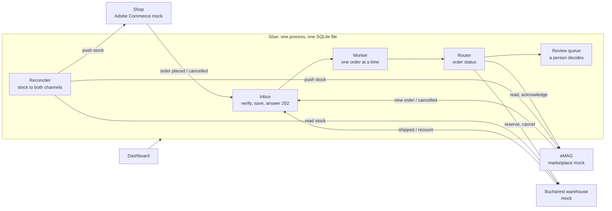
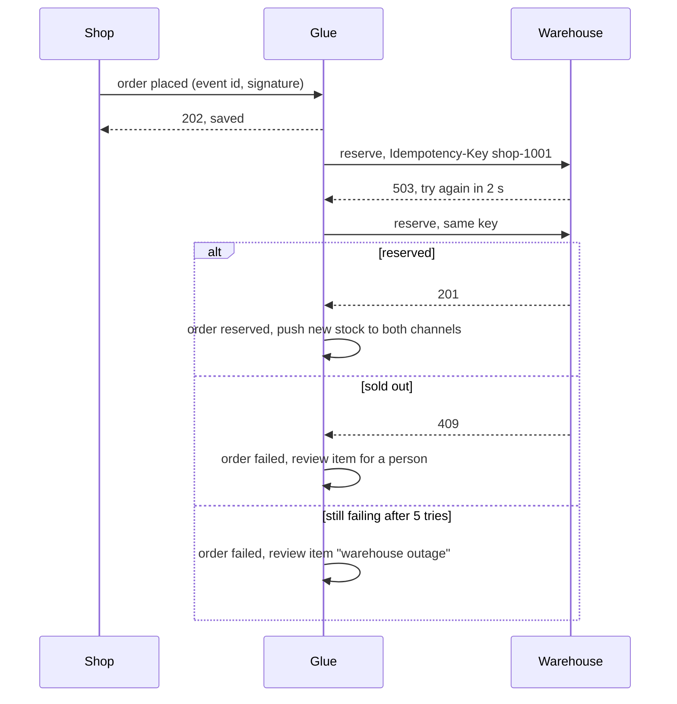
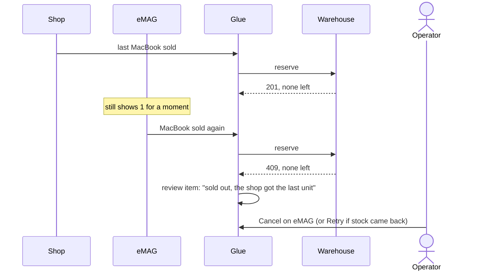
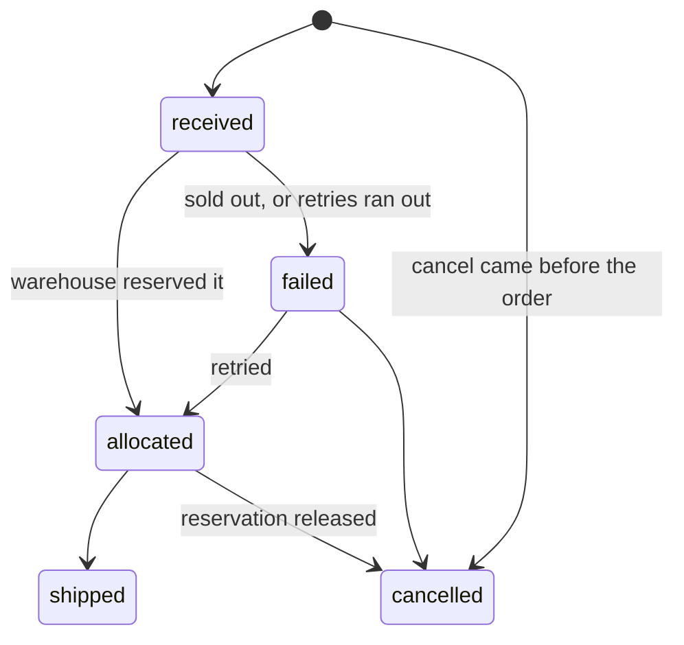

# Architecture

## Components

Every message coming in is signed and saved before any work starts. Every call going out uses the same retry policy (`glue/retry.py`). The three systems are mocks shaped like the real APIs, with switches to make them fail on purpose.

## A shop order, with a retry

An eMAG order works the same way, with two differences. eMAG only sends the order id, so Glue reads the order first. And eMAG keeps sending the notification until Glue acknowledges it, so if anything fails before the acknowledge, the next notification simply tries again. The order id stops it being reserved twice.

## Stock

The warehouse owns the stock. Every 10 seconds, and after every reservation, cancel or recount, Glue reads it and pushes the free figure to both channels:

**Free to sell = on the shelf minus reserved**, never below zero, minus any units a rule holds back.

It pushes every product every time, even when nothing changed, so a channel that restarted or missed an update is corrected on the next run. If eMAG refuses one product in a batch, only that product is marked "dirty" and sent again on the next run.

## Conflicts: the last unit sold twice

The first order to reach the warehouse gets the unit. The second one is already paid, and cancelling it on eMAG hurts the seller rating, so a person decides.

A **recount below reserved** is the other conflict: the warehouse finds fewer units than it promised. Glue sets both channels to 0 and sends only the newest orders the shelf cannot cover to review. If a later count covers them, Glue closes those items itself.

## Retries and partial failures

Every call out gets up to 5 tries, with a 2-second timeout each. Glue waits 0.5 s, then doubles it, with a little random jitter. If the other system says how long to wait (`Retry-After`), Glue does that, up to 30 seconds.

| What fails | Who fixes it |
|---|---|
| Warehouse down while placing an order | A person: **Retry** or **Retry all** when it is back (or the auto-retry rule) |
| Warehouse says sold out | A person decides |
| eMAG refuses one product in a stock batch | Glue, on the next run |
| eMAG read or acknowledge fails | Glue: eMAG sends the order again |
| A channel is not told an order shipped | A person: **Retry** tells it again |
| Glue stops in the middle of an order | Glue, on the next start (see below) |

## Duplicates

Messages can arrive twice from every system, so Glue drops repeats three ways:

1. **Event id:** a repeated message is dropped at the inbox.
2. **Order id:** the same order sent again under a new event id is recognised.
3. **Idempotency-Key:** if the warehouse reserved an order but its answer was lost, the retry gets the first answer back instead of a second reservation.

Exactly once is not possible across three systems. At least once plus these three checks gives "effectively once".

## Crash safety

Each change in Glue is saved together with its audit row (and its review item, if there is one) in one database transaction: all or nothing. A call to another system cannot be part of that transaction, so every such call is safe to repeat, and what still fails goes to a person.

| If Glue stops after… | On restart |
|---|---|
| saving an incoming message | It is processed as usual. |
| saving the order, before the warehouse answered | The order is sent again with the same key, so the warehouse does not reserve twice. |
| the warehouse reserved, before Glue recorded it | Same as above: the warehouse returns its first answer. |
| recording a failure | The failed order and its review item were saved together, so the item is there. |
| the warehouse cancelled, before Glue recorded it | The cancel is sent again; the warehouse answers the same way. |
| the order shipped, before the channel was told | The channel is told; it is never told twice. |
| a person's decision was half done | The decision is reopened or closed, depending on where the order got to. |

**Proof:** `tests/test_crash_points.py` stops Glue before each of its 132 database writes, in 11 different flows, restarts it, and checks that the result is the same as a run that never stopped. Before the fixes it led to, 41 of those stops left something wrong.

## Order states

Only `glue/router.py` changes an order's status.
