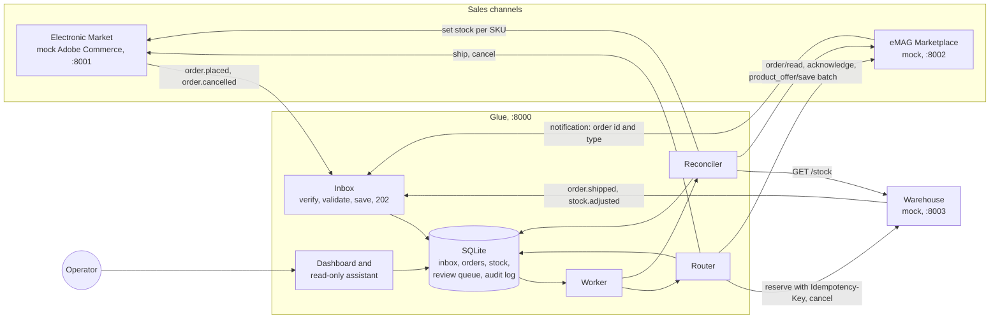
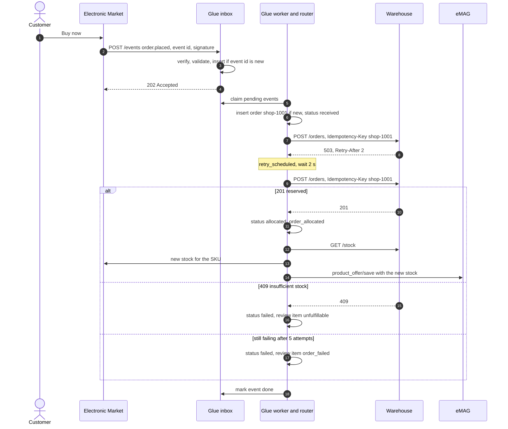
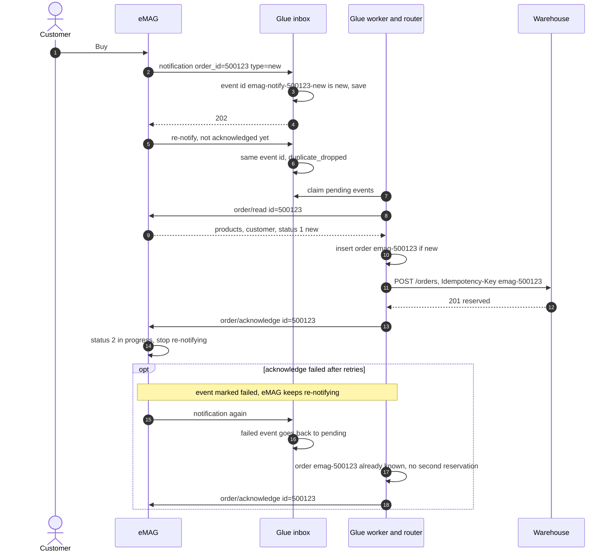
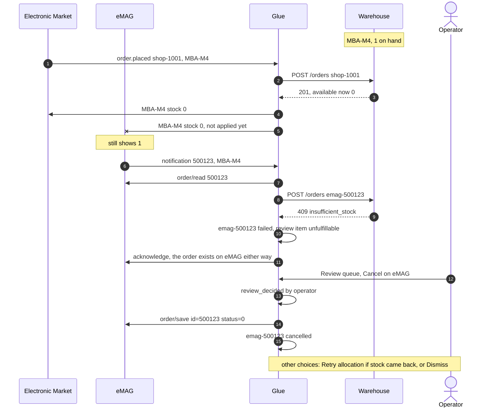
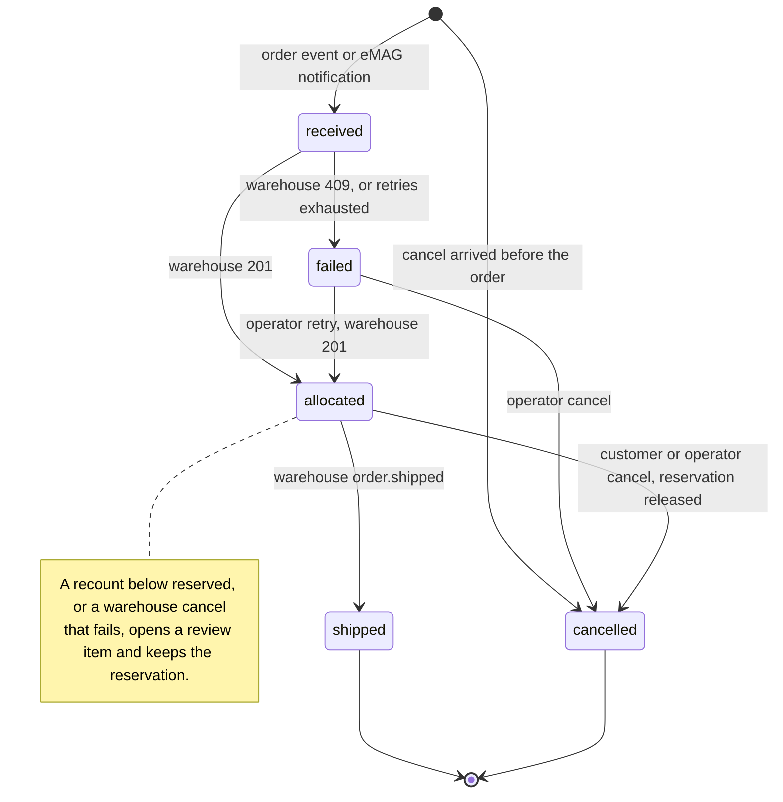

# Architecture

## Diagram

All three inbound arrows are signed webhooks. Every other arrow is a call the glue makes, wrapped in the same retry policy.

## Components

**Mocks.** Each mock is a small FastAPI app with a page for a person and an API shaped like the real system's. Each also has a `/chaos` endpoint the dashboard's demo controls call to break it on purpose.

- *Electronic Market* (Adobe Commerce shape). Sends `order.placed` and `order.cancelled` with an `x-adobe-event-id`. Accepts stock updates on `PUT /V1/products/{sku}/stockItems`, plus ship and cancel calls.
- *eMAG Marketplace* (Marketplace API v4 shape). Notifies the glue with only the order id and type, and re-sends every 20 seconds until the order is acknowledged. Orders are read with `order/read`, moved with `order/save` using numeric statuses, and stock arrives in batches through `product_offer/save`, which reports success per item.
- *Warehouse*. Owns the stock (`on_hand`, `reserved`). Reserves orders atomically, replays an earlier result for a repeated `Idempotency-Key`, and refuses with 409 when stock is short. Sends `order.shipped` and `stock.adjusted` after a recount.

**Glue.** One FastAPI process with one SQLite file.

| Module | Job |
|---|---|
| `inbox.py` | Checks the signature and the schema, saves the event if its id is new, answers 202. Does no other work. |
| `worker.py` | Claims pending events and runs one task per event, at most 10 at a time. Any unexpected error marks the event failed and opens a review item, so no order disappears silently. |
| `router.py` | The only code that changes an order's status: place, import from eMAG, cancel, mark shipped. |
| `reconciler.py` | Reads warehouse stock, pushes the sellable figure (`max(0, on_hand − reserved)`) to both channels, records what each channel accepted, and opens review items when a recount leaves less than is reserved. |
| `review.py` | Opens items (one open item per order and kind) and runs a person's decision. |
| `retry.py` | The single retry policy used for every outbound call. |
| `audit.py` | Writes one audit row per event in the system and the matching JSON log line. |
| `web.py`, `views.py`, `demo.py` | Dashboard pages, `/metrics`, demo controls. |
| `assistant.py` | Gemini tool loop over four read-only tools. |

## Data flow

### A shop order, end to end, with a retry

### An eMAG order: notify, read, allocate, acknowledge

eMAG's re-notification is its at-least-once delivery. The glue leans on it: if anything fails before the acknowledge, the order is simply imported again on the next notification, and the order id stops it being reserved twice.

### Stock

After every allocation or cancellation the reconciler pushes the affected SKUs. It also runs at startup (channels start at 0), every 10 seconds for all SKUs, and on every `stock.adjusted` from the warehouse. Each run pushes every SKU it covers, even when the glue thinks the channel already has that figure: a restarted channel or one that ignored an update is corrected on the next run. Runs hold one lock, so a slower run cannot overwrite a newer figure with an older one.

## Conflict handling

The conflict that matters is the cross-channel oversell. Both channels show the last unit for a moment, and two customers pay for it.

The rule is **first to reach the warehouse wins**. The warehouse's reservation is atomic, so exactly one order gets the unit. The other is refused with 409, and the glue does not decide what happens to a paid order on its own:

The review item shows the channel, the lines and the reason. Cancelling on eMAG costs seller rating, so that choice stays with a person. Other choices: retry the allocation once stock is back, or dismiss after handling it outside the system.

The second conflict is a **recount below reserved**: the warehouse finds fewer units than it has promised. The glue caps both channels at 0 for that SKU and opens one `unfulfillable` item per allocated order of it. It cannot know which customer should lose out, so retry is not offered (those orders still hold a reservation); the person cancels the ones that cannot be filled.

What the review queue allows depends on the order's current state:

| Kind | Meaning | Retry | Cancel | Dismiss |
|---|---|---|---|---|
| `order_failed` | Technical: retries exhausted, unexpected answer, or a warehouse cancel that did not go through | Repeats the operation that failed, only from the state it left the order in | On the order's channel, unless already shipped or cancelled | Close with a note |
| `unfulfillable` | Business: the channel accepted it, the warehouse cannot fill it | Places it again (stock may be back), only if the order is failed | Same | Same |

A decision closes the item before acting, so a retry that fails again opens a fresh item with the new reason.

## Order states

When a cancel overtakes the order it cancels (events are not ordered), the glue stores a cancelled stub. When the order arrives later it is recorded as `placed_after_cancel` and never reserved.

## Retries and partial failures

**Policy (`glue/retry.py`).** Every outbound call goes through one function. It retries transport errors, timeouts (2 s per call), 408, 429 and 5xx, up to 5 attempts. The wait is the server's `Retry-After` when given, otherwise 0.5 s doubled each attempt with up to 20% random jitter, so many clients do not retry at the same moment. Any other answer (2xx, 4xx such as 409) goes back to the caller, which decides what it means. Each retry writes a `retry_scheduled` audit row and bumps the order's `attempts`.

**Partial failures** and who fixes them:

| What fails | What the glue does | Fixed by |
|---|---|---|
| Warehouse down or slow while placing | Retries, then order `failed` and an `order_failed` item | Operator: Retry allocation |
| Warehouse refuses the order (409) | Order `failed`, `unfulfillable` item | Operator |
| Warehouse unreachable during reconcile | Keeps the last known stock, writes one `warehouse_unreachable` row (not one per run) | Itself, next run |
| eMAG `order/read` fails | Event marked failed, review item opened | Itself: eMAG re-notifies until acknowledged |
| eMAG `acknowledge` fails after the reservation | Event marked failed | Itself: the re-notification finds the order known and only acknowledges |
| Stock push to the shop fails, eMAG rate limits, or eMAG rejects one SKU in a batch | That channel's row for that SKU is marked dirty, `stock_push_failed`; the rest of the batch applies | Itself, next run |
| Warehouse cancel fails, or the order was already shipped | Order stays allocated, `order_failed` item for the cancel | Operator: Retry cancel, or handle it as a return |
| Unexpected error in a handler | Event failed, `event_failed` row, review item | Operator; a redelivery retries the event |
| Glue stops mid-event | Events left `processing` go back to `pending` at startup | Itself; handlers are idempotent |

## Idempotency

Duplicates are expected from every source, so the glue removes them at three layers:

1. **Transport: the event id.** The inbox's primary key is the event id: `x-adobe-event-id` for the shop and warehouse, `emag-notify-<order id>-<type>` for eMAG (eMAG notifications carry no id of their own). A repeat is answered 202 and recorded as `duplicate_dropped`. The exception is an event whose processing failed: a redelivery puts it back in the queue, which is how eMAG's re-notification heals failures.
2. **Business: the channel order id.** Orders are keyed `<channel>-<channel order id>` (`shop-1001`, `emag-500123`). An order seen before, for example an Adobe redelivery under a new event id or an eMAG order re-imported after a failed acknowledge, is recorded as `order_known` and not placed again.
3. **Outbound: `Idempotency-Key`.** Every reservation request carries the glue order id. If the warehouse reserved the order but its answer was lost, the retry gets the original answer back instead of a second reservation. Refusals are not remembered, so a retry after stock returns can succeed.
