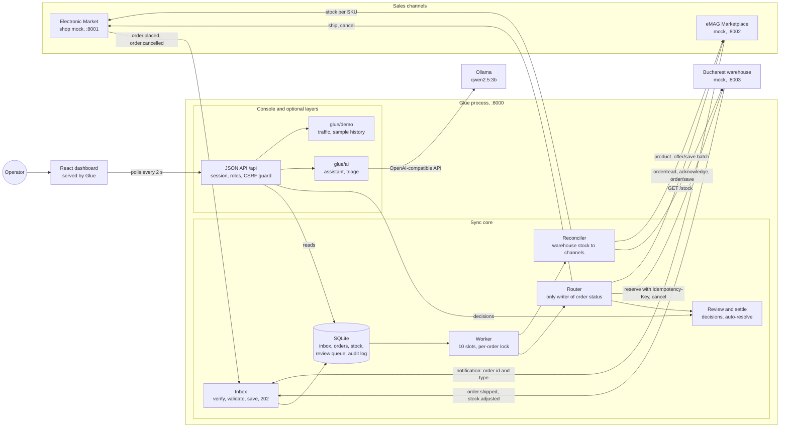
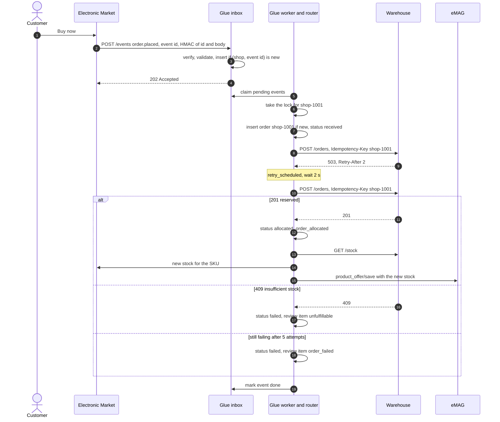
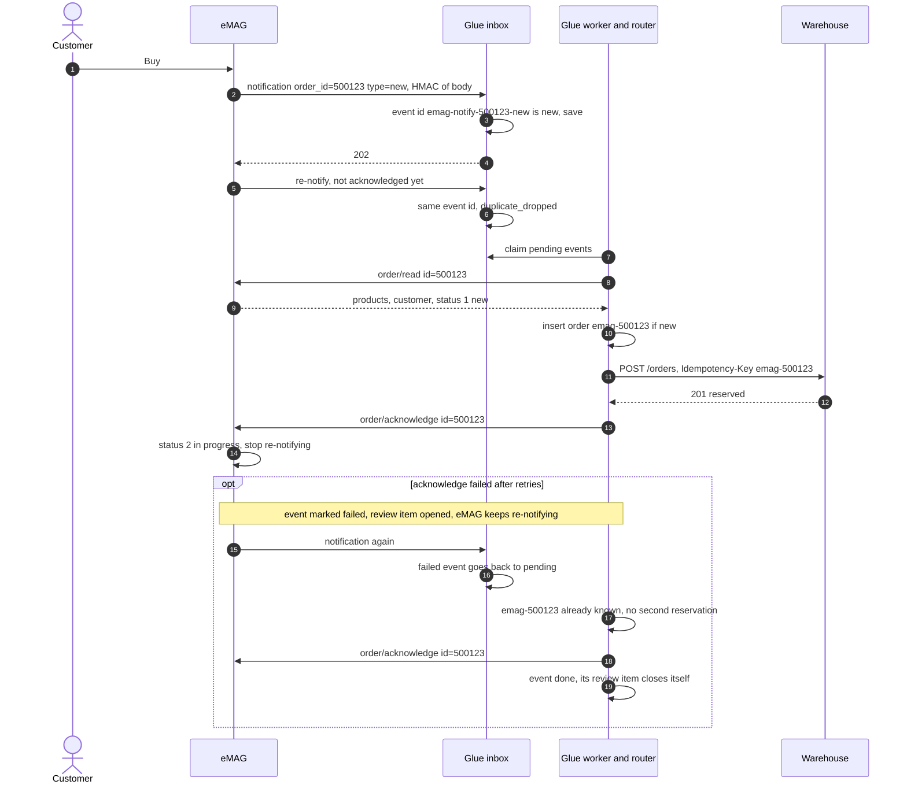
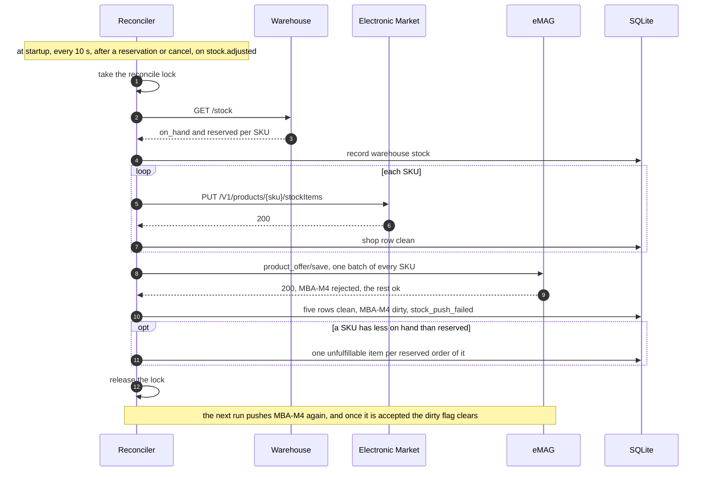
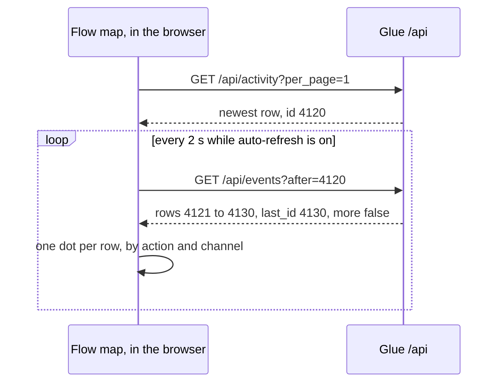
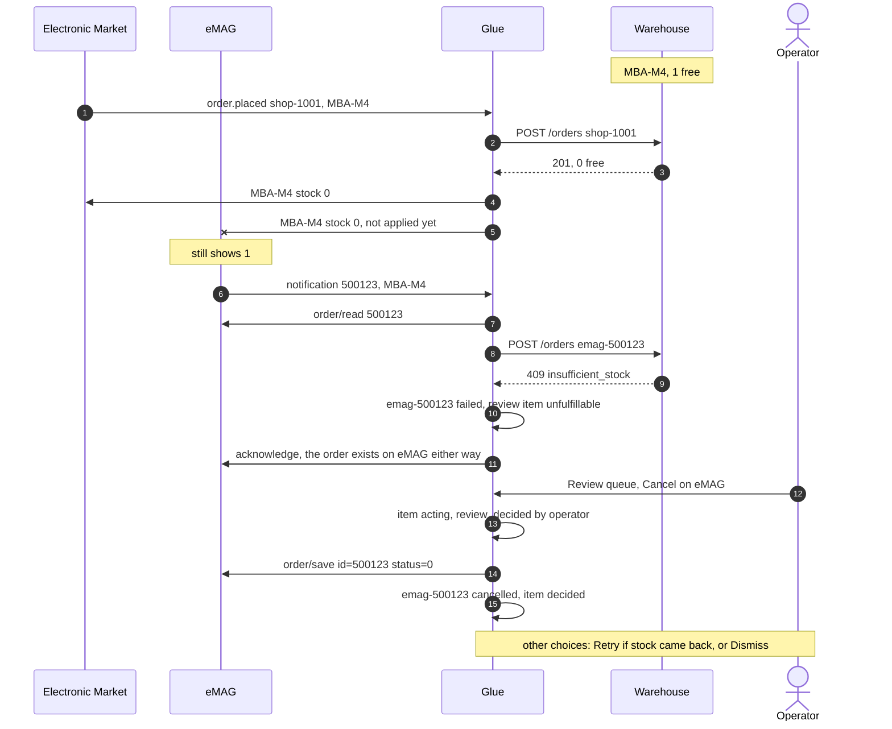
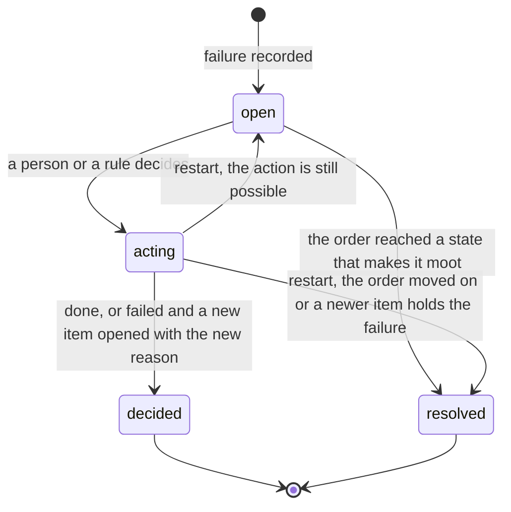
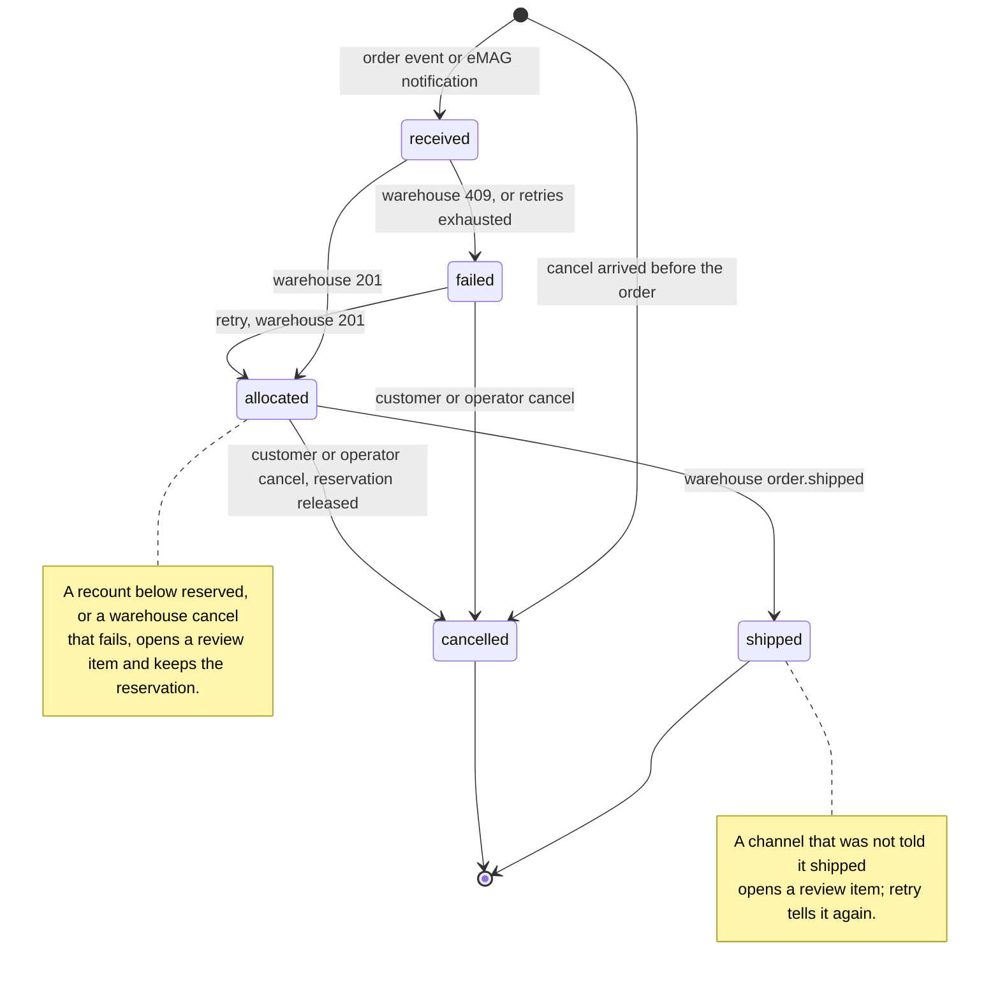

# Architecture

## Components

The three inbound arrows are signed webhooks. Every call Glue makes to the shop, eMAG and the warehouse goes through the same retry policy. Every core module reads and writes the one SQLite file; the diagram shows only the inbox saving and the worker claiming. Not drawn: the demo layer calling the mocks directly (orders, shipments, recounts, fault switches).

Glue is one FastAPI process with one SQLite file. On start it runs the migrations, puts unfinished work back in the queue, pushes stock to both channels, then starts four loops: the worker, the reconciler, the model download, and demo traffic. It serves the webhooks, the JSON API and the built dashboard from one port.

**Mocks.** Each mock is a small FastAPI app with a page for a person (server-rendered Jinja, plain HTML forms) and an API shaped like the real system's. Each has a `/chaos` endpoint the dashboard's demo controls use to break it, or make it act, on purpose. They keep state in memory.

- *Electronic Market* (Adobe Commerce shape). Sends `order.placed` and `order.cancelled` with an `x-adobe-event-id`. Accepts stock on `PUT /V1/products/{sku}/stockItems`, and ship and cancel calls.
- *eMAG Marketplace* (Marketplace API v4 shape). Notifies Glue with only the order id and type, and re-sends every 20 seconds until the order is acknowledged. Orders are read with `order/read`, moved with `order/save` and numeric statuses; stock arrives in batches through `product_offer/save`, which reports success per item. Faults: rate limit (429, `Retry-After: 1`), refuse one SKU, ignore stock updates, down.
- *Bucharest warehouse*. Owns the stock (`on_hand`, `reserved`). Reserves orders atomically, replays the earlier answer for a repeated `Idempotency-Key`, refuses with 409 when stock is short. Sends `order.shipped` and, after a recount, `stock.adjusted`. Faults: down (503, `Retry-After: 2`), slow (3 s, longer than Glue's 2 s timeout), fail the next N placements.

## Core, console, AI and demo

| Layer | What it is | Runs in production |
|---|---|---|
| Sync core | Inbox, worker, router, retry, reconciler, review and settle, rules, the database | Yes |
| Operator console | JSON API, the React dashboard, read models, analytics, sign-in and roles | Yes |
| AI helpers | Read-only assistant and triage suggestions, on a local model | Optional |
| Demo layer | The three mocks, demo traffic, sample history, fault switches | No |

Apart from `glue/main.py`, which wires everything together, the core does not import the console or the AI helpers. `glue/context.py` holds two outside types: the model client and the demo traffic state.

## Modules

**Sync core, `glue/`:**

| Module | Job |
|---|---|
| `inbox.py` | `/events` and `/emag/notifications`. Checks the signature, the schema, and that the source may send that event type about that order; saves the event if `(source, event id)` is new; answers 202. No other work. |
| `worker.py` | Claims pending events, one task per event, at most `WORKER_CONCURRENCY` (10). Takes the order's lock, runs the handler, and turns any unexpected error into a failed event and a review item. |
| `router.py` | The only code that changes an order's status: place (with the business-level dedupe), import from eMAG, cancel, cancel on the channel, ship and tell the channel. |
| `retry.py` | The one retry policy for every outbound call. Parses and caps `Retry-After`. |
| `reconciler.py` | Reads the warehouse's stock, pushes the sellable figure to both channels, records what each accepted (dirty when refused), opens review items when a recount leaves less than is reserved, and notices a warehouse recovery. |
| `review.py` | Opens items (one open item per order, kind and failed operation), classifies their cause, says which actions are allowed, and carries out a decision crash-safe. **Retry all** for an outage. |
| `settle.py` | Closes items that an order's new state makes moot, and on start settles decisions a stop cut short. |
| `rules.py` | The two admin rules: the stock buffer (`held_back`) and auto-retry after a warehouse recovery. |
| `db.py`, `schema.sql` | All SQL: the migrations, the startup resets, every query, the gauges. The deliberate exception to the ~150-line module size. |
| `context.py` | What every handler shares: settings, clients, the database, and the in-memory locks and flags. |
| `audit.py` | The list of audit actions; `record()` writes the row and the matching JSON log line. |
| `clients.py` | One small class per system. Ids are URL-encoded into paths. |
| `settings.py`, `tuning.py` | Environment configuration, and the live settings an admin changes (stored in the `settings` table). |
| `main.py` | App factory, startup and shutdown, `/health`, `/metrics`. |

**Operator console:**

| Module | Job |
|---|---|
| `glue/api/` | One router per dashboard area: `session`, `overview`, `orders`, `stock`, `review`, `activity`, `events` (the live cursor), `analytics`, `assistant`, `admin` (settings, users, rules), `demo`. Every route sits behind the cross-site guard, and every protected route declares its permission. |
| `glue/queries.py` | Read models: counters, stock rows and their state, review items with their allowed actions, system health, `/metrics`. |
| `glue/analytics.py`, `analytics_series.py`, `ranges.py` | The Flow page's report, computed from the audit log, and the time windows. |
| `glue/auth.py`, `guard.py` | Session cookie, roles, `require(permission)`; the cross-site guard. |
| `glue/spa.py` | Serves the built dashboard, and `index.html` for its client-side routes. |
| `frontend/src/api/` | `fetch` wrapper (adds `X-Glue-Request: 1` to writes, sends to sign-in on 401), TanStack Query hooks, the events cursor. |
| `frontend/src/pages/` | One folder per page: Overview, Flow, Orders, OrderDetail, Stock, Review, Activity, Assistant, Demo, Rules, Settings, Users. |
| `frontend/src/features/` | `flowmap/` (the live map and its dots), `palette/` (the Ctrl+K command palette). |
| `frontend/src/components/`, `layout/`, `lib/`, `styles/` | Shared components, the app shell, labels and formatting, CSS tokens. |

**AI helpers, `glue/ai/`:** `llm.py` (client, model status, one-time download with progress), `assistant.py` (tool loop over four read-only tools), `triage.py` (asks for a suggestion, filters it, stores it), `triage_prompt.py` (the facts and the rule, built in code).

**Demo layer:** `glue/demo/traffic.py` (random orders, shipments, restocks, and the one-off actions), `glue/demo/sample.py` and `sample_orders.py` (30 days of seeded history), `glue/api/demo.py` (the routes). The mocks are `shop/`, `emag/` and `warehouse/`, each split into `main.py` (app, faults, health), `api.py` (what Glue calls) and `pages.py` (the page and its forms). `common/` holds what they share with Glue: models, signing, the event emitter, the catalogue.

## Data flow

### A shop order, end to end, with a retry

### An eMAG order: notify, read, allocate, acknowledge

eMAG's re-notification is its at-least-once delivery, and Glue leans on it. If anything fails before the acknowledge, the order is imported again on the next notification, and the order id stops it being reserved twice. A cancel notification (`type=cancelled`) reads the order and cancels it the same way a shop cancel does.

### Stock: reconcile with a partial batch failure

Each run pushes every SKU it covers, even when Glue thinks the channel already has that figure, so a restarted channel or one that ignored an update is corrected on the next run. The figure is `max(0, on_hand − reserved)`, minus whatever the stock buffer rule holds back for that channel and SKU. Runs hold one lock, so a slower run cannot overwrite a newer figure with an older one. A 429 or an outage on the whole batch is retried, then every row in it is marked dirty.

A dirty row keeps the time of the last push the channel accepted, so its age on `/metrics` says how long that channel has been behind. A warehouse that cannot be read is recorded once (`warehouse_unreachable`), not once per run, and the last known stock stays.

A run that reaches the warehouse after runs that could not is a recovery. After releasing the lock it applies the auto-retry rule: every open `order_failed` item whose placement never went through is retried as an operator's **Retry** would be, decided by `rule:auto-retry` and audited as `rule_applied`.

## The live map: an events cursor

The Overview's live map shows one dot per audit row as it happens. It polls a cursor instead of re-reading a window:

`/api/events` returns at most 200 rows after the given id, plus `more` when there are others, and the client asks again until it has caught up. The first poll starts at the newest row, so opening the page never replays old history, and the cursor is dropped when the map is not on screen. Sample history rows are left out: they are weeks old.

## Analytics

The Flow page and the Overview's period view read `/api/analytics`, computed on each request from the audit rows in the window (`glue/analytics.py`):

- **Trips.** An inbound placement event names the event, not the order; the order rows it caused share its correlation id. That links each received order to its first `order_allocated`, and gives the time from received to reserved.
- **Buckets.** Per minute for the live 15 minutes, per hour for today, per day for the last 7 days, this month or a custom range (up to a year).
- **Report.** The funnel (received, duplicates, sent to the warehouse, reserved first try, after a retry, failed), orders per channel, retries and failures per bucket, p50 and p95 time to reserve, SKUs out of sync per channel, a panel per system, orders by product, failure causes, and optionally the previous window of the same length. **Export CSV** gives the buckets.
- **Orders lost** counts orders placed in the window that are failed or never got a row in Glue, with no open review item. In practice, a failure dismissed without a fix.
- **Longest outage** is an estimate. Nothing is logged when the warehouse comes back, so an outage runs from the first retry or `warehouse_unreachable` to the next thing the warehouse answered.

**Sample history** (Demo controls) inserts 30 days of generated orders and audit rows, the same every time (fixed seed). They are marked in the audit detail and use order ids like `shop-sample-12`, which real ids cannot match, so **Clear sample history** removes exactly them.

## Conflict handling

The conflict that matters is the cross-channel oversell. Both channels show the last unit for a moment, and two customers pay for it.

The rule is **first to reach the warehouse wins**. The warehouse's reservation is atomic, so exactly one order gets the unit. The other is refused with 409, and Glue does not decide alone what happens to a paid order:

Cancelling on eMAG costs seller rating, so that choice stays with a person.

The second conflict is a **recount below reserved**: the warehouse finds fewer units than it has promised. Glue caps both channels at 0 for that SKU and opens one `unfulfillable` item per reserved order of it. It cannot know which customer should lose out, and those orders still hold a reservation, so retry is not offered; a person cancels the ones that cannot be filled.

## The review queue

Two kinds of item: `order_failed` (technical: retries exhausted, an unexpected answer, a cancel or ship notice that did not go through) and `unfulfillable` (business: the channel sold it, the warehouse cannot fill it). Each item records which operation failed (`place`, `cancel` or `ship`). There is at most one open item per order, kind and operation, so a failed ship notice never hides behind a failed cancel.

The **cause** groups items on the Review page: `outage` (an `order_failed` whose reason shows a 5xx, a timeout or a connection error), `soldout`, `recount` and `other`. **Retry all** works on `outage` only, and only while the warehouse answers.

What a decision may do depends on the order's state now, not when the item opened (`review.allowed_actions`):

| Action | Allowed when | Does |
|---|---|---|
| Retry | The order is in the state the failed operation left it: `failed` for a placement, `allocated` for a cancel, `shipped` for a ship notice | Repeats that operation |
| Cancel | The order exists and is not shipped or cancelled | Cancels on the order's channel, then releases the reservation if it holds one |
| Dismiss | Always, while the item is open | Closes it with no change |

Deciding needs the `decide` permission and is recorded under the signed-in user. Decisions and events for one order take the same lock, so an operator's cancel and a customer's cancel never both reach the warehouse.

### Item states

`acting` is the inbox's crash trick applied a second time. The item leaves `open` before the action, so a retry that fails again can open a fresh item with the new reason, and a process that dies mid-action leaves it `acting` for the next start to settle (`settle.interrupted_decisions`). An `acting` item still counts as waiting everywhere the queue is listed or counted, and offers no actions. `resolved` is stored as `decided` with action `resolved` by `glue`.

Glue resolves an item itself when it becomes moot (`glue/settle.py`): a failed placement once the order is shipped or cancelled, a failed cancel once the order is cancelled, and an item opened by a failed event once that same event goes through on redelivery. A failed cancel on an order that then shipped stays open: that needs a person.

## Order states

When a cancel overtakes the order (events are not ordered), Glue stores a cancelled stub. When the order arrives later it is recorded as `placed_after_cancel` and never reserved.

## Retries and partial failures

**Policy (`glue/retry.py`).** Every outbound call goes through one function. It retries transport errors, timeouts (2 s per call), 408, 429 and 5xx, up to 5 attempts (an admin setting). The wait is the server's `Retry-After` when it is readable, as seconds or an HTTP date, capped at 30 seconds because waiting holds a worker slot. Otherwise it is 0.5 s doubled each attempt, plus up to 20% random jitter so many clients do not retry together. Any other answer (2xx, or a 4xx such as 409) goes back to the caller, which decides what it means. Each retry writes a `retry_scheduled` row and bumps the order's `attempts`.

**Partial failures, and who fixes them:**

| What fails | What Glue does | Fixed by |
|---|---|---|
| Warehouse down or slow while placing | Retries, then order `failed` and an `order_failed` item | Operator **Retry** or **Retry all**, or the auto-retry rule once the warehouse answers |
| Warehouse refuses the order (409) | Order `failed`, `unfulfillable` item | Operator |
| Warehouse unreachable during reconcile | Keeps the last known stock, one `warehouse_unreachable` row | Itself, next run |
| eMAG `order/read` fails | Event failed, review item | Itself: eMAG re-notifies until acknowledged; the item closes when the event goes through |
| eMAG `acknowledge` fails after the reservation | Event failed, review item | Itself: the re-notification finds the order known, only acknowledges, and the item closes |
| Stock push to the shop fails, eMAG rate limits, or eMAG rejects one SKU in a batch | That channel's row for that SKU is dirty, `stock_push_failed`; the rest of the batch applies | Itself, next run |
| Warehouse cancel fails, or the order already shipped | Order stays allocated, `order_failed` item for the cancel | Operator: **Retry** the cancel, or handle it as a return |
| The channel is not told an order shipped | Order stays shipped, `order_failed` item for the ship notice | Operator **Retry**, which tells the channel again |
| Unexpected error in a handler | Event failed, `event_failed` row, review item | Operator; a redelivery retries the event |
| Glue stops mid-event | The event stays `processing`; on start it goes back to `pending` | Itself; handlers are idempotent |
| Glue stops mid-decision | The item stays `acting`; on start it is reopened or resolved | Itself, or the operator decides again |

## Idempotency

Duplicates are expected from every source, so Glue removes them at three layers:

1. **Transport: `(source, event id)`.** The inbox's primary key. The event id is `x-adobe-event-id` for the shop and the warehouse, and `emag-notify-<order id>-<type>` for eMAG, whose notifications carry no id of their own. An id is only unique for the system that sent it, so one sender's id cannot hide another's event. A repeat is answered 202 and recorded as `duplicate_dropped`. The exception is an event whose processing failed: a redelivery puts it back in the queue, which is how eMAG's re-notification heals failures.
2. **Business: the channel order id.** Orders are keyed `<channel>-<channel order id>` (`shop-1001`, `emag-500123`). An order seen before (an Adobe redelivery under a new event id, an eMAG order re-imported after a failed acknowledge) is recorded as `order_known` and not placed again. The exception is an order still `received` that nobody is sending: Glue stopped between saving it and recording the warehouse's answer, so it is sent again (`allocation_resumed`).
3. **Outbound: `Idempotency-Key`.** Every reservation request carries the Glue order id. If the warehouse reserved the order but its answer was lost, the retry gets the original answer back instead of a second reservation. Refusals are not remembered, so a retry after stock returns can succeed.

## Concurrency

All of it is asyncio in one process (`glue/context.py`):

- **Worker slots.** At most `WORKER_CONCURRENCY` events run at once. The loop claims only as many events as there are free slots and, when all are busy, claims again as soon as one frees.
- **Per-order lock.** Events and review decisions for one order run one at a time; different orders run in parallel. Locks live in a weak dictionary and disappear when nothing holds them. The worker takes the order's lock, then a slot. `asyncio.Lock` is not reentrant; the auto-retry rule decides from inside a task that holds the lock of an order it just reserved or cancelled, which is safe because it only retries `failed` orders, so it never waits on the lock its own task holds.
- **Reconcile lock.** One stock run at a time.
- **`sending`.** The orders currently being sent to the warehouse, so a re-import of a `received` order does not send it a second time.

At scale these become workers partitioned by order id and one elected reconciler (see the README's Scalability section).

## Startup, shutdown and migrations

- **Migrations.** `glue/db.py` keeps an ordered list of steps; `PRAGMA user_version` counts how many a database has had. Each missing step runs in its own transaction with its version bump. Step 1 is `schema.sql`, frozen as every existing database already has it; step 2 re-keyed the inbox on `(source, event_id)`. A volume from an earlier version upgrades in place.
- **Resets.** Events left `processing` go back to `pending`; items left `acting` are settled as above.
- **Startup.** Stock is pushed to both channels before any event is processed, because channels start at 0.
- **Shutdown.** The four loops are cancelled and awaited before the database closes.

## AI

Both helpers use a local model (`qwen2.5:3b` on Ollama, through the openai SDK). Glue starts without it, downloads it once in the background (about 2 GB, progress on the Assistant page) and retries every 10 seconds while Ollama is unreachable. Until the model is ready, the endpoints answer 503 with the reason.

- **Assistant.** A tool loop over four read-only functions: `get_summary` (counts and recently changed orders, 1 to 168 hours), `list_review_items`, `get_order` (with its timeline) and `get_stock`. The system prompt tells it to answer only from tool results. There is no tool that changes anything, so a question, or text hidden in order data, can at worst produce a wrong answer.
- **Triage.** On a review item, Glue assembles the facts in code (cause, what Glue saw, the order's lines, stock, whether the warehouse answers now) and picks the recommendation by a rule in code (`glue/ai/triage_prompt.py`). The model only writes the reason. Its answer is kept only if the action is one the item allows and the reason does not name a different order. The suggestion is stored on the item, audited as `triage_suggested`, and never acts. The small model follows a rule that names one choice but not a conditional one, which is why the condition is checked in Python.
- **Limits.** Effort (2, 4 or 6 tool rounds), tokens per answer and a daily token budget, stored in the `settings` table and changed by an admin. They exist for when this points at a paid model. The model list shows Claude, GPT and Gemini as "coming soon"; nothing calls them.
